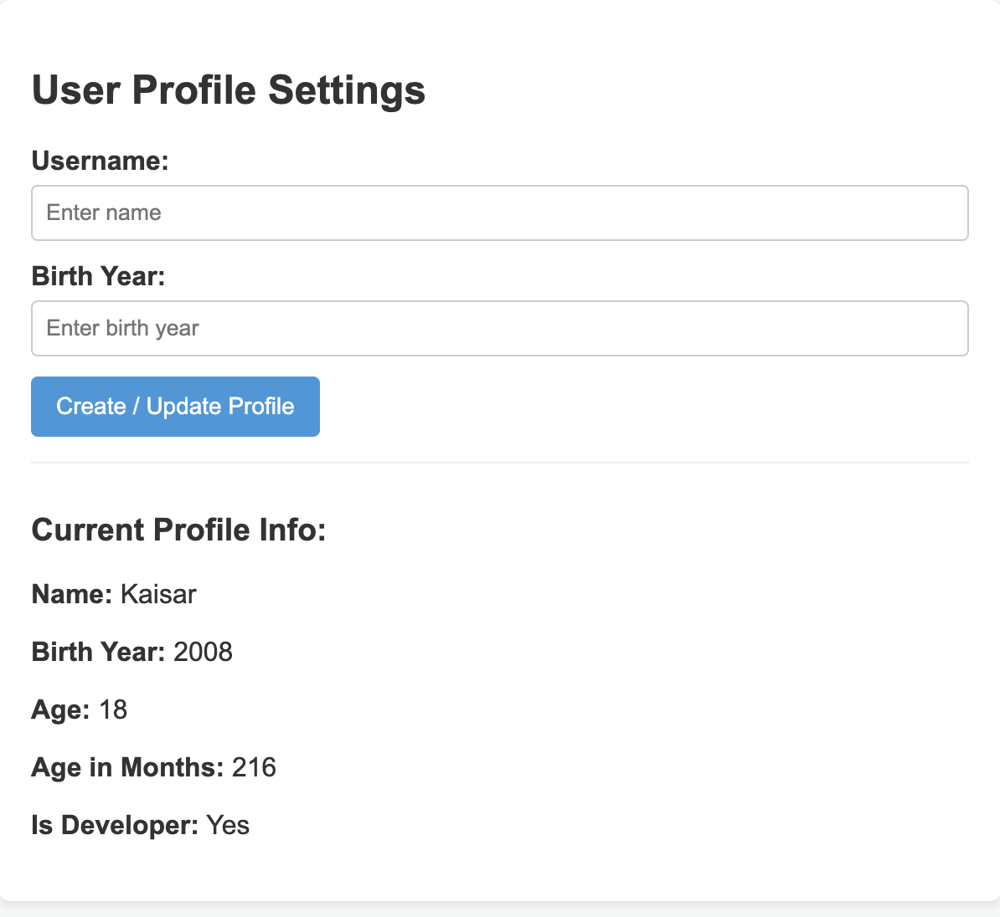
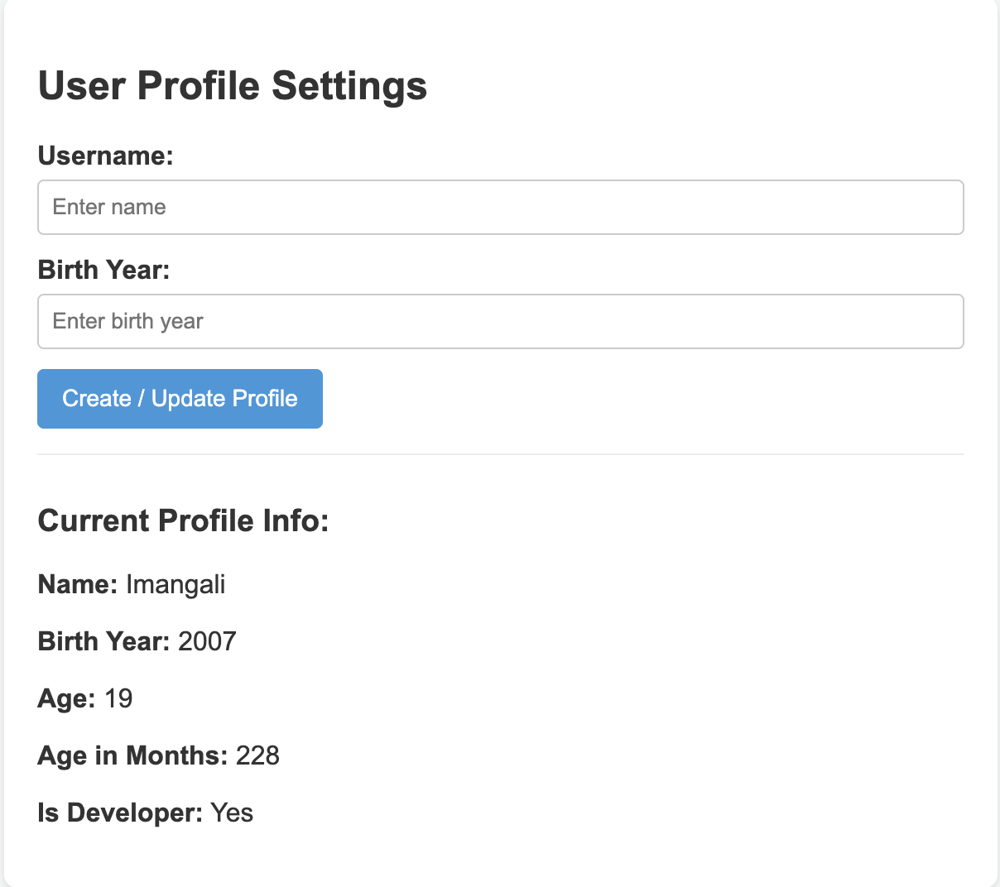
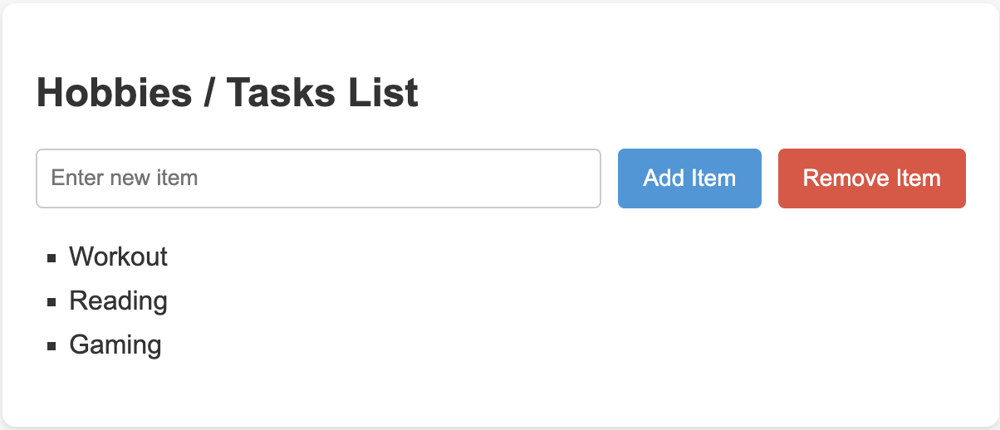

Assignment #5: JavaScript Basics (DOM Manipulation & Events)
Name: Kaisar Ashimbay

Group: SE-2540

Overview
In this assignment, I created an interactive web page to practice fundamental JavaScript concepts: objects, data types, arithmetic operations, DOM selection, event listeners, and dynamic list manipulation.

Task Breakdown & Screenshots
Part 1: Profile Object, Data Types & Arithmetic
Created a userProfile object in JavaScript containing various data types (string, number, boolean, array). Calculated the current age and age in months dynamically using arithmetic operators, and logged the initial profile data to the browser console.

Part 2: Form Input & Event Responses
Created an HTML form with inputs for Username and Birth Year. Added a submit event listener to capture user input, update the userProfile object, dynamically recalculate the age, and update the displayed info on the page without reloading.

Part 3: DOM List Manipulation
Created an interactive list for hobbies/tasks with "Add Item" and "Remove Item" buttons.

Add Item: Takes input text, creates a new <li> element using DOM manipulation, appends it to the list, and pushes it to the hobbies array.

Remove Item: Removes the last <li> element from the list using removeChild() and updates the array using .pop().

Summary
During this assignment, I learned how to structure data in JS objects, select and manipulate DOM elements, handle form submissions, and dynamically modify list items on a webpage. I also practiced logging results to the console and deploying the page to GitHub Pages.